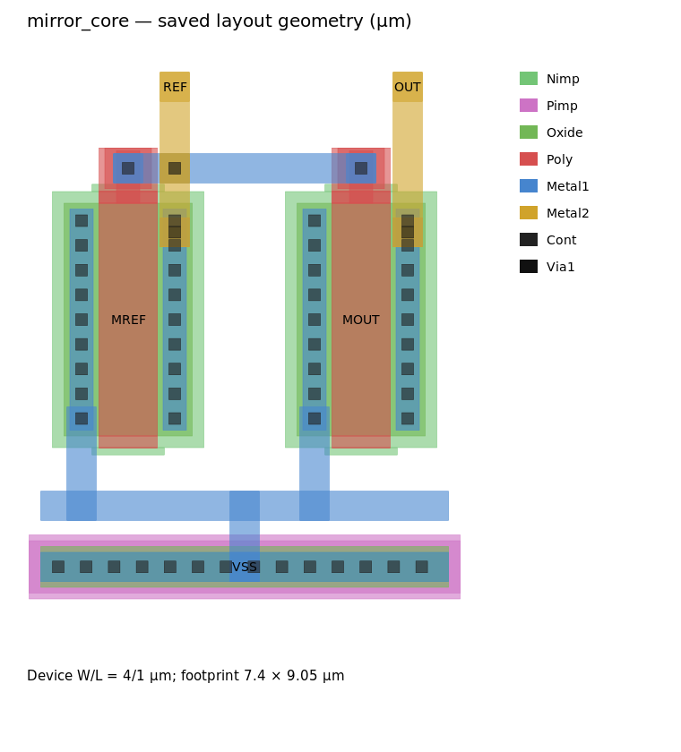

# Fresh VM workflow evaluation — November 4, 2026

Cadex is useful as a design teammate, but common operations still incur too much
mechanical recovery. Four fresh VM Codex sessions reached correct functional or
saved-database outcomes without follow-up prompts. That does not make the live
experience polished: two failed live jobs left partial unsaved work, and a newly
opened view needed an evaluator-driven display refresh before it was visible.
The next investment should be reliable edit primitives and operation feedback,
not another broad role skill or a larger agent hierarchy.

## Method and boundaries

Tested installed source: `fda113f`. Actual VM entrypoint
`~/.local/bin/codex` resolves to standalone CLI 0.166.0. Sessions used its normal
configured `gpt-6.1-sol`, `--approve-for-me`, fresh context and short task prompts.
No model/settings override, saved permission change, bypass flag or candidate
follow-up was used. Project context supplied only normal launch paths, fixture
contracts and safety scope; the live case additionally identified the sole
authorized test session and its private registry. Skill names were not in the
requests. These are four samples, not a reliability estimate or a controlled
before/after comparison of the role wording.

Only disposable, evaluator-created projects and cellviews were used. The private
GUI had its own authenticated Xvfb display, runtime copy, registry and logs.
Runtime copying changed only bootstrap/configuration paths; the installed live
client, bridge and editing code were exercised. A read-only query showed 55 of
4,200 framework licenses in use before testing. The test GUI, bridge server and
private X display were removed afterward using only their recorded identities.
No existing GUI, TigerVNC display, user design or working project was contacted.
All 41 protected installed/configuration files retained their hashes.

Private evidence root on ECE:

```text
~/.local/state/cadex/workflow-evals/collaboration_20261104_xv92vawi/
```

Raw event streams, requests, GUI logs, native results and databases stay there.
They are not committed: in particular, live RPC logs can contain session nonces.
[Public scorecard](../tests/evals/workflow-smoke/2026-11-04-results.json) and
[task/acceptance inputs](../tests/evals/workflow-smoke/cases.json) contain sanitized
results. The GUI refresh and independent checks below happened after the
candidate finished and are not counted as unassisted candidate behavior.

## Tasks and actual results

| Task | Candidate time / shell commands | Independent outcome |
| --- | --- | --- |
| Create a VAMS bench, test and give feedback; preserve the DAC | 2m25s / 13 | Correctly exposed the seeded reference-update defect. All 464 voltage samples recomputed independently; four failed as expected. |
| Set VBIAS to 0.7 V, move it down, check/save | 2m26s / 18 | Saved 0.7 V; source and local ground moved -0.25; all ten pins meet wire geometry; original net maps, neighbors and other cell preserved. Label translation caveat below. |
| Lay out a simple current mirror and verify it | 6m08s / 41 | Independent DRC zero and LVS match: two 4/1 µm NMOS, three ports. All 110 rendered rectangles match independently reopened saved geometry. |
| Set VBIAS to 0.65 V and move it down in the private GUI | 3m36s / 29 | Installed live helper used; eventual saved result independently confirmed with another batch process. Fresh live clients reconnected to the same GUI and opened another existing view. UI caveat below. |

All candidate CLI exits were zero. Native bench failure is a different result:
the DAC intentionally violates its contract and the generated runner correctly
returns nonzero. Candidate commands totaled 101; 16 returned nonzero, including
expected failing DUT checks and DRC results, one busy-lock refusal, and mechanical
errors. Treating every nonzero as an agent mistake would misrepresent this test.

Summed candidate time was 14m34s, excluding fixture preparation, research,
independent verification and evaluator diagnosis. Reported model usage includes
116,937 uncached input tokens and 21,293 output tokens, plus repeated cached
input. These are not whole-evaluation costs or unique-context sizes; no dollar
cost is inferred.

### VAMS testbench and feedback

The block is a six-bit wreal DAC with output `vref * code / 64` when enabled and
zero when disabled. The seeded defect omits reference changes from its event
sensitivity. The agent read the specification, selected the relevant skills,
noticed that discrepancy, and reproduced it rather than modifying the DUT.

It swept all 64 codes up and down at 0.6, 1.2 and 1.8 V references, tested disable
and re-enable, and exercised reference-only changes. Of 464 voltage checks,
460 passed and four failed. At code 32, reference 0.9 → 1.2 V left output at
0.45 V instead of 0.60 V. The original model hash remained unchanged.

The evaluator reused the generated bench in separate copies:

| Model variant | Native runner exit | Aggregate failures |
| --- | --- | --- |
| Corrected reference sensitivity | 0 | 0 |
| Wrong gain denominator | 1 | 386 |
| Wrong disabled output | 1 | 68 |
| Stuck-zero output | 1 | 575 |

The last aggregate includes monotonicity failures as well as voltage mismatches.
This positive control plus negative controls is stronger evidence than simply
seeing the deliberately broken original fail. The final response explained the
cause and correctly distinguished real-number behavior from electrical loading,
settling and glitch verification. This was useful pair-design feedback.

Friction: the first ordinary-sandbox `xrun -version` died with a bad-system-call
error. Reviewed execution worked. The first bench used `$fatal`, unsupported in
the selected VAMS compilation mode; it recovered using checked completion/failure
markers. Site setup also removed `rg` from PATH, requiring a `grep` correction.
The agent recreated an environment/result runner because Cadex has no managed
Xcelium execution helper. None of these required user intervention.

This validates event-driven wreal/RNM through Xcelium, not electrical AMS
co-simulation, connect rules or behavioral-to-transistor equivalence.

### Saved schematic edit

The agent inspected the source and neighborhood, included G0 and local wire/label
geometry, checked the baseline, and saved only after zero errors/warnings with
connectivity extraction and both recorded rule checks enabled. A separate process
reopened the saved view. The evaluator independently checked the voltage, source
and ground translation, every terminal-to-net map, pin-on-wire geometry, unchanged
M0/VOUT/G1, untouched neighboring cell and absence of instance-box overlap.

One failed attempt used the PDK-style `vfoSetParam` path on the analogLib source.
It recovered by inspecting saved state and using the verified native dc property.
However, the BIAS label moved -0.50 while the source moved -0.25: moving its wire
already translated the attached label, which the job then moved again. It stayed
on the correct wire with clear spacing here. The circuit outcome passed; this
exposes a child-geometry ownership problem, not a universally safe move operation.

The agent chose the legacy direct batch launcher, placing logs in `cadence/runs/`
rather than the configured labeled results area. That path remains supported,
but the current skill routes offer competing defaults for configured projects.

### Layout

The agent inspected native PCell parameters, pins, technology and command
references, built a same-orientation side-by-side pair with equal source straps,
shared gate routing and a continuous contacted substrate return, and iterated on
real verification results. DRC counts went 32 → 4 → 0, correcting contact enclosure
and poly-notch violations. Independent final DRC returned zero real/flat errors;
independent LVS matched both devices and REF/OUT/VSS without changing schematics.

The footprint is 7.4 × 9.05 µm. I viewed the image below and checked its complete
rectangle multiset against a separate saved-database export. This is a saved
geometry rendering, not a TigerVNC screenshot.



The agent's notes explicitly describe the absence of common-centroid segmentation,
dummies, statistical mismatch analysis, extraction and post-layout simulation.
Default DRC excludes separate density/antenna checks. This is a sensible basic
prototype, not demonstrated current-ratio precision or tapeout readiness.

Friction included a nonexistent `python` command, unavailable Matplotlib, a
missing guessed venv directory, and a refused parallel DRC/LVS call because the
helper serializes licensed work per project. It recovered with standard-library
SVG/ImageMagick and reran verification sequentially. A temporary PCell probe did
not leave an extra saved cell in the library. Physical iteration itself is normal;
repeated environment discovery and opaque failure reporting are the avoidable part.

### Actual live route and visual completion

The fourth session used the installed live helper against only the private
registry/session. It initially misplaced `--session` in the CLI, guessed a
nonexistent `python`, then hit `cadexParam`'s callback assumption. A repair attempt
replaced a wire without preserving its attached label, creating floating nets.
The managed checker refused to save. The agent inspected its own partial work,
repaired it, restored zero errors/warnings and saved. It did not seek user help.

Independent saved-file inspection confirmed 0.65 V, a -0.25 source/ground move,
all ten pin/wire contacts, preserved net maps and unchanged neighbors. Fresh
clients returned to the same GUI PID/start identity; opening the other existing
view succeeded there; the GUI remained running after clients disconnected.

The first screenshot of that newly opened view showed a blank canvas despite
valid view bounds and a populated database. A separate evaluator job using
Cadence-documented view bounds/zoom and redraw made the schematic visible.
This is a reproducible completion concern to isolate further: the experiment
combined zoom, raise and redraw, so it does not identify which action was decisive.
The inspection path also skips the helper's explicit redraw. Do not claim that
native readback proves painting, or generalize this private-display result to a
TigerVNC defect. No observation from the user was needed or requested.

Teardown confirmed the private GUI/server were gone, its X display lock was gone,
and metadata-only status identified the record as stale without contacting a GUI.
The generic batch smoke then completed with STATUS=0, a completion marker and
12 libraries. No batch driver was loaded into the live process.

## Priorities supported by the evidence

1. **Reliable local edit operations and useful failures.** Resolve the supported
   parameter/property path before mutation, and handle attached-label ownership
   when moving/deleting/stretching wires. Preserve the original requested-state
   assertions across failed attempts. Report the failing SKILL cause, pending
   changes and checker delta without requiring full CIW-log dumps. Connection
   errors may offer attach instructions; API/checker errors should not suggest
   reloading an already-connected GUI. Diagnostic exports should redact RPC nonces.
2. **One predictable execution path per workflow.** Add a thin reviewed Xcelium
   runner around existing project filelists/scripts; normalize completion and
   result provenance. Align configured batch guidance with the existing managed
   helper, retain legacy compatibility, and expose/queue project-busy state rather
   than forcing the agent to discover locking by failure. Publish actual runtime
   capabilities so it does not guess Python names, packages or environments.
3. **Native regression coverage of the everyday loop.** Keep these prompts and
   independent oracles; add repeated runs, rotated sources, shared buses, nearby
   objects, unsaved-edit recovery and closed-view painting. Verify original nets
   and geometry, not only checker totals. Include electrical AMS and an existing
   larger/hierarchical project before claiming broad mixed-signal coverage.

Structured DRC violations and verified PCell/contact/via recipes would also make
layout iteration cheaper. Readability belongs in the acceptance criteria, but a
longer list of prose restrictions will not fix native child-object semantics.
For reused GUI windows preserve the user's viewport; define and verify appropriate
initial framing/painting for newly opened targets.

## Comparison with public work

[SiliCAD EDA_MCP](https://github.com/SiliCAD/EDA_MCP) emphasizes persistent tool
sessions, physical-verification loops and workspace diff/history. Cadex already
has parts of those foundations; its current friction is in concrete operation
semantics and coherent result/diagnostic delivery. A window-first architecture
is not a reason to weaken explicit GUI opt-in or connect to arbitrary sessions.

[EDA_Agent's benchmark](https://raw.githubusercontent.com/HrishikeshGawasIIITH/EDA_Agent/main/docs/benchmark.md)
checks behavior by simulation and separates scoring from solving. It also reports
that retrieval added little on top of an already useful static API reference in
its paired comparison. The lesson here is focused grounding and independent
checks; that evidence does not justify a large RAG stack or comparisons between
its success rates and these four different tasks. Broad library scanning is not
appropriate without project authorization.

[LayoutCopilot](https://arxiv.org/html/2406.18873v3) distinguishes concrete editing
requests from higher-level design intent and emphasizes designer feedback. That
fits the two working contexts in our role statement. It does not imply one
mandatory worker per skill or require a classifier service for this setup.

[Cadence's agentic overview](https://www.cadence.com/en_US/home/ai/agentic-ai-super-agents.html)
also emphasizes engineering oversight and grounding in tools/solvers. That is
vendor positioning, not independent evidence that this UF setup achieves its
advertised productivity or signoff capabilities.

[OpenAI's skill-evaluation guidance](https://developers.openai.com/blog/eval-skills)
recommends checking outcome, process and efficiency with captured runs.
[Its current instruction guidance](https://developers.openai.com/blog/rethinking-skills-and-prompts-for-gpt-6-astra)
favors scoped instructions and conditional detail. These tests support that
approach: role framing and skill discovery were adequate; most avoidable work
was API, execution, geometry or feedback handling. The new pair/autonomous role
statement can stay short. No production framework changes were made during the
benchmark, and no changes proposed here have been silently deployed.
